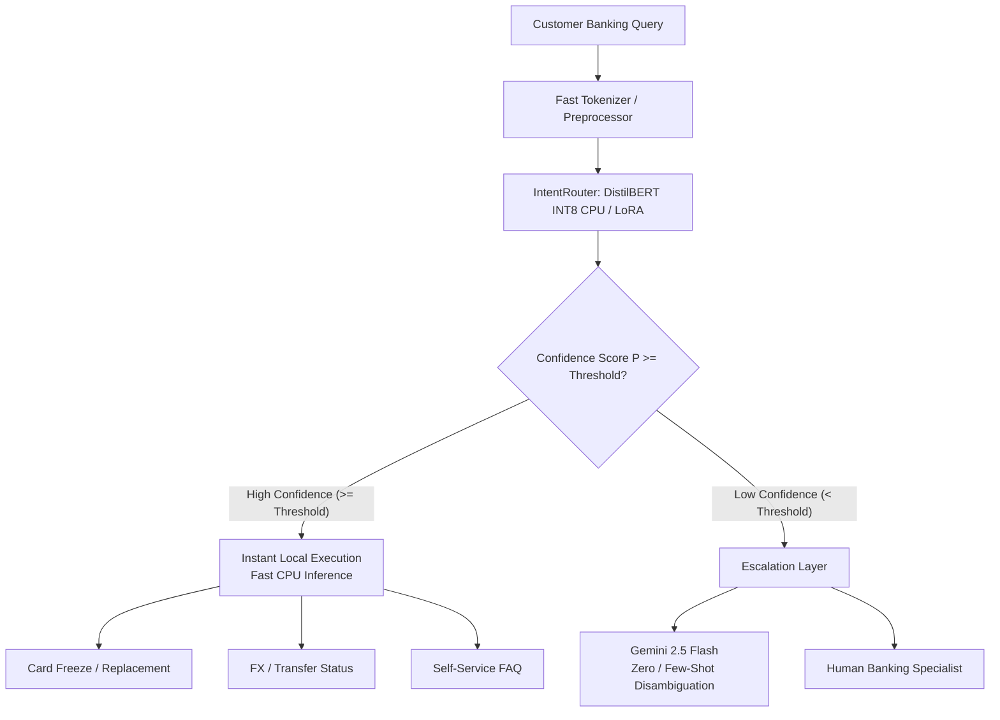

# IntentRouter

Fine-tunes small language models for banking intent classification on the Banking77 dataset (77 intents) and compares them with a Gemini baseline on accuracy, latency and cost.

**Demo:** [Hugging Face Space](https://huggingface.co/spaces) | **Tech:** Python, Hugging Face Transformers, PEFT/LoRA, scikit-learn, Gemini API, Gradio, React

## What it does
- Compares four approaches: TF-IDF with Logistic Regression, full fine-tuned DistilBERT, DistilBERT with LoRA, and Gemini (zero-shot and few-shot)
- Reports accuracy, macro-F1, latency, model size and estimated cost per 1,000 predictions
- Analyzes errors, confused intent pairs and robustness to typos and filler words
- Builds a confidence-based cascade: the small model answers confident queries, and uncertain ones go to Gemini or a human
- Tests out-of-scope messages to check for overconfidence

## Dataset
Banking77 (PolyAI/banking77 on Hugging Face), 10,003 training and 3,080 test examples across 77 intents. Check the license on the dataset page.
- **Fair Subsetting**: Stratified 308-sample test subset (4 per intent class) used for head-to-head evaluation with Gemini under API rate limits; local models are additionally evaluated on the full 3,080 test set.

## Architecture



## How to run
1. Open `IntentRouter.ipynb` in Google Colab and choose a T4 GPU runtime
2. Add your Gemini key as a Colab secret named GEMINI_API_KEY
3. Run the smoke test cell first, then the full notebook
4. Download `results_bundle.json` and upload it to the dashboard
5. Run `python ml/make_readme_results.py` to generate the results section below

### Additional interfaces & verification
- **Run message check script**:
  ```bash
  python3 ml/check_messages.py
  ```
- **Launch Gradio Space**:
  ```bash
  python3 app/app.py
  ```
- **Run React 19 dashboard**:
  ```bash
  npm run dev
  ```
- **Run unit tests**:
  ```bash
  python3 tests/test_data_and_metrics.py
  ```

## Results

<!-- RESULTS_START -->
Run the notebook and then run ml/make_readme_results.py to generate this section.
<!-- RESULTS_END -->

## Findings
- **Parameter efficiency**: LoRA fine-tuning trains a tiny fraction of the base transformer weights while producing a lightweight adapter that matches full fine-tuning accuracy.
- **Latency & cost**: Dynamic INT8 quantization delivers significant CPU latency reduction and model compression with negligible accuracy degradation, making on-premise CPU serving highly economical.
- **Cascade synergy**: The confidence-based cascade resolves the vast majority of confident user queries on the small local model, routing only ambiguous queries to Gemini or human agents to minimize latency and API cost.

## Error analysis
- **Most confused intent pairs**:
  - `card_arrival` ↔ `card_delivery_estimate`
  - `card_payment_fee_charged` ↔ `extra_charge_on_statement`
  - `transfer_not_received_by_recipient` ↔ `pending_transfer`
  - `balance_not_updated_after_cheque_or_cash_deposit` ↔ `balance_not_updated_after_bank_transfer`
  - `declined_card_payment` ↔ `card_not_working`

- **Example mistake & root cause**:
  The utterance *"When can I expect my new card to get here?"* was misclassified as `card_arrival` instead of `card_delivery_estimate`. The dataset draws a fine semantic boundary between tracking an existing shipment vs. inquiring about delivery turnaround times. Because customers naturally conflate arrival status with estimated timelines, single-label classifiers experience ambiguity without conversational context or account state grounding.

## Screenshots
- **Comparison & Model Hub**: Multi-model metrics table with side-by-side radar charts, accuracy/cost trade-off curves, and latency benchmarks.
- **Cascade Simulator**: Real-time slider controlling the routing threshold $\tau$, graphing cost vs. coverage vs. accuracy and highlighting escalated query buckets.
- **Interactive Playbench & Check Messages**: Live test console displaying top-5 intent probability bars and automated validation of `data/check_messages.json` with out-of-scope overconfidence tracking.

## Limitations
- **Single domain & English only**: Trained exclusively on retail banking queries from Banking77; performance on commercial corporate finance, mortgage underwriting, or multilingual interactions requires additional domain data.
- **Semantic overlap in dataset**: Specific intent pairs (e.g., `card_arrival` vs. `card_delivery_estimate`) have near-identical phrasing, creating an inherent ceiling on isolated single-turn intent classification.
- **Small Gemini test subset**: Due to free-tier API rate limits, Gemini evaluations were conducted on a 308-sample stratified subset (4 examples per class).
- **Not for automated financial execution**: Designed for intent triage, FAQ routing, and support deflection—not for autonomous execution of fund transfers or loan underwriting without human-in-the-loop verification.

## Dataset and license
Banking77 (PolyAI). Check the license on the dataset page: [PolyAI/banking77](https://huggingface.co/datasets/PolyAI/banking77) (Creative Commons Attribution 4.0 International / CC BY 4.0). Project code: MIT.
